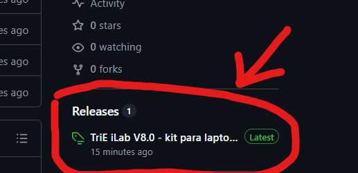
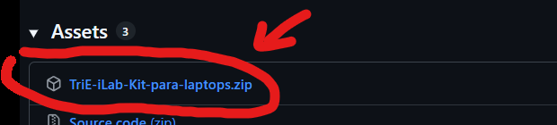
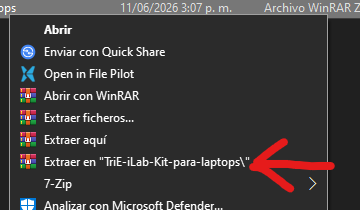
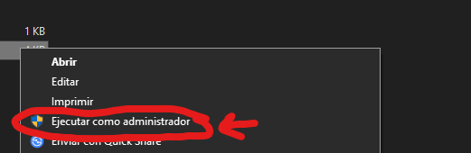
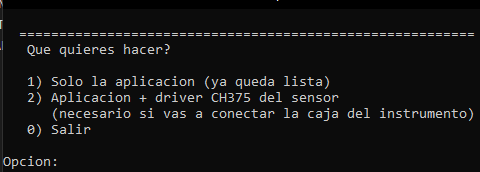

# TriE iLab V8.0 — fix de `CH375DLL.DLL` (Windows 10 / 11)

> [!IMPORTANT]
> **Trabajo escolar, con fines educativos y no comerciales.**
> TriE iLab V8.0 es software propietario de **WCH / TriE (W.ch)**, el
> fabricante de los instrumentos, y se incluye aquí porque venía en el CD del
> equipo de medición con el que se hizo la práctica.
> **No se modificó un solo byte** de los archivos del fabricante: lo único que
> se hizo fue copiar `CH375DLL.DLL` a la carpeta de los ejecutables.
> Lo que sí es trabajo propio es el diagnóstico, el instalador portable y las
> herramientas de análisis. → Ver [`NOTICE.md`](./NOTICE.md)

Este repo trae el **software de los instrumentos de medición** (TriE iLab V8.0)
ya reparado, más el instalador portable para ponerlo funcionando en cualquier
Windows 10/11 x64.

## El problema

Al abrir `DIS.exe` salía:

> La ejecución de código no puede continuar porque no se encontró CH375DLL.DLL.

No era el sistema operativo, ni el CD, ni los discos. **`DIS.exe` (Delphi 7,
32 bits, 2012) enlaza estáticamente con `CH375DLL.DLL`**, y esa DLL venía en la
subcarpeta `TriEiLab\Driver\`.

Windows **nunca busca DLLs en subcarpetas**. El orden de búsqueda es:

1. La carpeta desde donde se cargó el `.exe`
2. `System32`
3. Carpeta de 16 bits
4. Carpeta de Windows
5. El directorio actual
6. Las carpetas del `PATH`

Como `CH375DLL.DLL` solo estaba en `Driver\`, el proceso moría antes de
arrancar.

## La solución

Copiar `CH375DLL.DLL` **junto a los ejecutables**. Afecta a los cuatro:

| Archivo | Depende de `CH375DLL.DLL` |
|---|---|
| `DIS.exe` | sí (9 funciones) |
| `CCD.exe` | sí (8 funciones) |
| `Sound.exe` | sí (8 funciones) |
| `ReadData.exe` | sí (8 funciones) |

```
TriEiLab\
    DIS.exe
    CH375DLL.DLL   <-- acá (copiado desde Driver\)
    CCD.exe
    Sound.exe
    ReadData.exe
    Driver\        <-- original, se puede borrar
    Lang\          <-- traducciones (CHS / EN / ESP)
```

## 📖 Tutorial de instalación (Windows 10 / 11)

### 1) Descargar el kit

En la página del repositorio, baja a la sección **Releases**, en la columna de
la derecha, y abre la release:



Dentro de la release, en **Assets**, está el ZIP que hay que bajar:



### 2) Extraer el ZIP

Clic derecho sobre el ZIP descargado → **Extraer en "TriE-iLab-Kit-para-laptops"**:



Se crea una carpeta con esta estructura. **Importante:** el `.cmd` y la carpeta
`TriEiLab` tienen que quedar al mismo nivel:

```
TriE-iLab-Kit-para-laptops\
    INSTALAR EN LAPTOP.cmd
    LEEME.txt
    NOTICE.md
    README.md
    TriEiLab\
        DIS.exe
        CH375DLL.DLL     <-- la DLL reparada, ya en su sitio
        CCD.exe
        Sound.exe
        ReadData.exe
        Driver\
        Lang\
```

### 3) Ejecutar el instalador como administrador

Clic derecho en `INSTALAR EN LAPTOP.cmd` → **Ejecutar como administrador**:



Aparece el aviso de **Control de cuentas de usuario** (UAC): dale **Sí**.

### 4) Elegir qué instalar



| Opción | Qué hace exactamente | ¿Cuándo la uso? |
|---|---|---|
| **1) Solo la aplicación** | Deja el programa listo: quita el bloqueo de archivos de SmartScreen, verifica que `CH375DLL.DLL` esté junto a los `.exe`, crea el acceso directo **"TriE iLab"** en el Escritorio y abre la app. | Cuando **no** vas a conectar la caja del instrumento. La app abre y podés usar la interfaz, las gráficas y el análisis, pero las pestañas dirán **"Sin sensor"**. |
| **2) Aplicación + driver CH375 del sensor** | Todo lo de la opción 1, **más** la instalación del driver WCH de WCH (`pnputil /add-driver CH375WDM.INF /install`): registra el servicio `CH375WDM`, deja el driver preparado y copia `CH375DLL.DLL` a `SysWOW64`. Al final te dice si el sensor aparece conectado. | Cuando **sí** vas a usar la caja del instrumento por USB. Sin esto, Windows no reconoce el aparato y la app nunca deja de decir "Sin sensor". |
| **0) Salir** | Cierra el instalador sin hacer nada. | — |

Escribe el número y dale Enter. En algunos pasos Windows pide reiniciar; si
pasa, reinicia y ya está.

### 5) Conectar el sensor (opcional)

Con la opción 2 instalada, enchufa la caja del instrumento por USB. En el
**Administrador de dispositivos** debe aparecer como **"TriE USB Connection"**
(controlador WCH). Si no aparece, mira la sección
[Si algo falla](#-si-algo-falla) más abajo.

---

## ❓ Si algo falla

| Síntoma | Causa | Solución |
|---|---|---|
| "La ejecución de código no puede continuar porque no se encontró CH375DLL.DLL" | La DLL quedó en `Driver\` y Windows no busca ahí | Corre `INSTALAR EN LAPTOP.cmd` (opción 1). El error desaparece. |
| El driver no instala en Windows 11 | **Integridad de memoria (HVCI)** bloquea los drivers de 2011 | Seguridad de Windows → Seguridad del dispositivo → Integridad de memoria → Desactivar → reiniciar → repetir opción 2. |
| "Windows protegió tu PC" | SmartScreen marca el `.exe` sin firma digital | Más información → Ejecutar de todas formas. (El instalador ya le quita la marca de "archivo descargado", pero a veces el ZIP la arrastra.) |
| Aviso en chino "警告 / 程序已经在运行" | El programa ya está corriendo | Ciérralo y ábrelo otra vez. Es un mensaje de la propia DLL. |
| Las 4 pestañas dicen "Sin sensor" | Falta la caja, o falta el driver | Conecta el USB y revisa que hayas elegido la **opción 2** y reiniciado tras instalar el driver. |
| Al abrirlo pide permisos de administrador | `DIS.exe` lo pide siempre | Es normal: su manifiesto dice `requireAdministrator`. |

---

## 🔧 Qué hace el instalador por dentro

| Acción | Para qué |
|---|---|
| Se auto-eleva con UAC | Escribir en `HKLM\SOFTWARE\WinChipHead\IC\CH375` y en `SysWOW64` requiere admin. |
| `Unblock-File` sobre todo | Quita la marca de "archivo descargado" (MOTB) para que SmartScreen no bloquee los `.exe`. |
| Copia `Driver\CH375DLL.DLL` a la raíz | **Este es el arreglo**: Windows solo busca la DLL en la carpeta del `.exe`. |
| `pnputil /add-driver ... /install` | Instala el driver CH375 y su DLL en `SysWOW64`. |
| `pnputil /enum-devices` | Comprueba si el sensor quedó conectado. |
| Crea el acceso directo "TriE iLab" | Deja el programa a mano en el Escritorio. |

## 🔌 El sensor y el driver CH375 (WCH)

Sin el sensor físico la app abre igual, pero las 4 pestañas de la pantalla
principal muestran **"Sin sensor"**.

- Driver: `Driver\CH375WDM.INF` (CH372/CH375/CH376, WDM, v2.6 — 2011).
- El catálogo está firmado por **Microsoft (WHQL)** → instala en Windows 10/11.
- IDs de hardware: `USB\VID_4348&PID_5537`, `VID_1A86&PID_5537`,
  `VID_1A86&PID_5576`, `VID_4348&PID_55E0`. El dispositivo aparece como
  **"TriE USB Connection"**.
- El driver instala la DLL en `SysWOW64` (por eso el `.exe` de 32 bits la
  encuentra sola si el driver está instalado).
- El driver es de 2011 y **no es compatible con HVCI / Integridad de memoria**,
  que es lo único que suele complicar la instalación en Windows 11:

> Seguridad de Windows → Seguridad del dispositivo → Integridad de memoria →
> Desactivar → reiniciar → repetir la instalación.

## Notas

- `DIS.exe` tiene `requireAdministrator` en su manifiesto → **siempre pide
  permisos de administrador** al abrir. Es normal, no es un error.
- Los textos internos de `CH375DLL.DLL` están en chino simplificado (GBK), por
  eso algunos mensajes salen con caracteres raros (ej. "警告 / 程序已经在运行" =
  "Advertencia: el programa ya se está ejecutando"). Es solo cosmético.
- La app guarda su configuración en `setup.ini` (dentro de la carpeta) y escribe
  en `HKLM\SOFTWARE\WinChipHead\IC\CH375` → por eso necesita admin.
